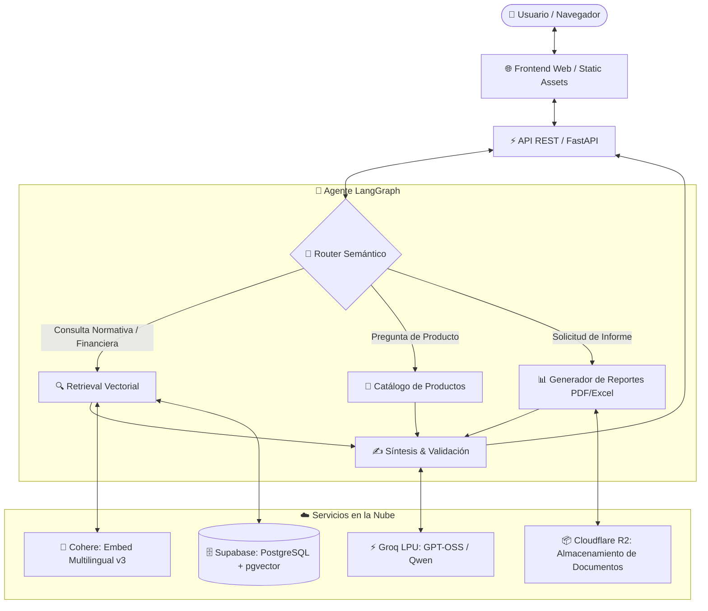

# 🥛 Agente RAG Corporativo Alpina

[](https://dylan-hernandez-agente-alpina.vercel.app/)
[](https://www.python.org/)
[](https://fastapi.tiangolo.com/)
[](https://langchain-ai.github.io/langgraph/)
[](https://supabase.com/)
[](https://groq.com/)
[](https://cohere.com/)
[](https://www.cloudflare.com/products/r2/)

> 🌐 **URL de Producción en Vivo**: **[https://dylan-hernandez-agente-alpina.vercel.app](https://dylan-hernandez-agente-alpina.vercel.app)**  
> **Proyecto Desarrollado por**: Dylan Hernández  
> **Área / Asignatura**: Módulo de Inteligencia Artificial  
> **Sistema**: Asistente RAG Multi-Agente Corporativo con Trazabilidad Auditable y Generación de Reportes

---

## 📌 Descripción del Proyecto

El **Agente RAG Corporativo de Alpina** es una solución integral de Inteligencia Artificial diseñada para responder preguntas estratégicas, financieras, regulatorias y de producto para la compañía **Alpina Productos Alimenticios S.A. BIC**.

A diferencia de los asistentes conversacionales genéricos, este sistema opera bajo un paradigma de **cero alucinaciones y estricta trazabilidad documental**: cada afirmación se sustenta en fuentes oficiales (estados financieros 2024-2025, catálogo de productos y resoluciones del Ministerio de Salud y Protección Social de Colombia), permitiendo al usuario visualizar el fragmento y la página exacta del documento original mediante un visor de evidencias integrado.

Además, cuenta con capacidades de **Tool Calling** para generar automáticamente informes ejecutivos en formato **PDF** y hojas de cálculo avanzadas en **Excel** con gráficos dinámicos.

---

## 🚀 Capacidades Principales

1. **🧠 Orquestación Multi-Agente (LangGraph)**:
   - **Router Semántico**: Clasifica la intención del usuario (consulta de catálogo, búsqueda normativa/financiera, generación de reportes o síntesis conversacional).
   - **Recuperador RAG Híbrido**: Búsqueda vectorial mediante distancia coseno sobre representaciones de 1.024 dimensiones generadas con Cohere Multilingual v3.
   - **Invocador de Herramientas (*Tool Calling*)**: Generador dinámico de reportes ejecutivos financieros y normativos en PDF y Excel.
   - **Validador de Trazabilidad**: Filtra y formatea las citas oficiales para garantizar que ninguna respuesta carezca de respaldo documental.

2. **🔍 Trazabilidad y Citas Auditables**:
   - Cada respuesta incluye tarjetas de "Fuentes Oficiales Citadas".
   - Al hacer clic en una cita, la interfaz abre el **Visor de Evidencias**, renderizando la página del documento PDF con el fragmento de texto exacto destacado visualmente.

3. **📊 Generación Automatizada de Reportes (Dossier Ejecutivo)**:
   - **Reportes en Excel (`.xlsx`)**: Con formatos numéricos de moneda, tablas estilizadas, fórmulas automáticas y gráficos de barras integrados con `openpyxl`.
   - **Informes Ejecutivos en PDF (`.pdf`)**: Con membrete corporativo, tipografía profesional, tablas de datos y paginación con `ReportLab`.
   - Descarga directa en el chat y visualización previa en el Dossier Ejecutivo lateral.

4. **🥛 Catálogo Interactivo de Productos y Sellos de Advertencia**:
   - Consulta de precios, gramajes, ingredientes y tablas nutricionales de marcas emblemáticas (Alpinito, Bon Yurt, Arequipe, Leches, Yogures, Quesos).
   - Evaluación de sellos frontales de advertencia en cumplimiento de la **Resolución 810 de 2021** y la **Resolución 2492 de 2022** (Exceso de Sodio, Azúcares Añadidos y Grasas Saturadas).

5. **⚡ Arquitectura "Zero-Footprint" y Máxima Portabilidad**:
   - **Sin Docker ni bases de datos locales**: Todo el almacenamiento vectorial reside en **Supabase (pgvector)** y los documentos en **Cloudflare R2** (con degradación automática a almacenamiento local).
   - **Inicio en 1 Clic en Windows**: Mediante el archivo por lotes `iniciar.bat`, que gestiona automáticamente el entorno virtual, instala dependencias y levanta la aplicación sin configuraciones complejas.

---

## 🏗️ Arquitectura del Sistema



---

## 📂 Estructura del Proyecto

```text
Dylan_Hernandez-Agente_Alpina/
├── app/                           # Código fuente del backend y frontend
│   ├── agent/                     # Orquestación LangGraph, prompts, validación y LLMs
│   │   ├── graph.py               # Grafo de estados y flujo de ejecución
│   │   ├── llm.py                 # Clientes Groq y estrategias de fallback
│   │   ├── prompts.py             # Prompts de sistema y directrices corporativas
│   │   ├── trace.py               # Rastreo de fuentes y citas auditables
│   │   └── validation.py          # Validación de salidas y anti-alucinación
│   ├── api/                       # Capa de controladores y rutas FastAPI
│   │   ├── routes/                # Endpoints (chats, documents, products, reports, system)
│   │   ├── schemas/               # Modelos Pydantic de entrada/salida
│   │   └── router.py              # Enrutador principal de la API
│   ├── core/                      # Seguridad, CORS y middlewares
│   ├── db/                        # Conexión y pooling con Supabase (psycopg3)
│   ├── documents/                 # Modelos y metadatos de documentos oficiales
│   ├── ingestion/                 # Pipeline de ingesta y chunking de documentos
│   ├── products/                  # Catálogo de productos Alpina y reglas de sellos
│   ├── reports/                   # Generadores ejecutivos de Excel y PDF
│   │   ├── excel.py               # Generación con openpyxl y gráficos
│   │   ├── pdf.py                 # Generación con ReportLab
│   │   └── service.py             # Orquestación de reportes y almacenamiento
│   ├── retrieval/                 # Búsqueda semántica vectorial (Cohere + pgvector)
│   ├── static/                    # Frontend Web (HTML5, CSS3, JavaScript Vanilla)
│   │   ├── brand/                 # Logotipos y favicon oficial de Alpina
│   │   ├── css/                   # Estilos modulares (chat, dossier, modal, inspector)
│   │   ├── js/                    # Controladores de UI, API, estados y visor PDF
│   │   └── index.html             # Interfaz web principal
│   ├── storage/                   # Conector Cloudflare R2 con fallback a disco local
│   ├── config.py                  # Configuración global y lectura de .env
│   └── main.py                    # Punto de entrada de la aplicación FastAPI
├── data/                          # Directorio de datos locales
│   ├── cache/                     # Caché de páginas renderizadas
│   ├── processed/                 # Textos procesados
│   ├── raw/                       # Documentos PDF originales
│   └── reports/                   # Almacenamiento local de reportes generados
├── .env.example                   # Plantilla para el archivo .env local
├── .gitignore                     # Exclusión de archivos temporales y entornos
├── iniciar.bat                    # Script universal de arranque en 1 clic (Windows)
├── LEEME.txt                      # Instrucciones breves de inicio rápido en texto plano
├── PORTABILITY.md                 # Guía detallada de portabilidad y solución de problemas
├── pyproject.toml                 # Metadatos del proyecto y especificación PEP 621
└── requirements.txt               # Dependencias de producción estrictas
```

---

## ⚡ Inicio Rápido (Quickstart)

### Opción A: En Windows (1 Solo Clic) 🏆

1. Clona o descomprime el proyecto.
2. Crea `.env` a partir de `.env.example` y configura las credenciales de tu entorno.
3. Ejecuta `iniciar.bat` con doble clic. El script prepara el entorno, comprueba el esquema de la base de datos y abre `http://127.0.0.1:8000` en el navegador.

---

### Opción B: Inicio Manual (Linux / macOS / PowerShell)

```bash
# 1. Crear el entorno virtual con Python 3.12 a 3.14
python3 -m venv .venv

# 2. Activar el entorno virtual
# En Linux / macOS:
source .venv/bin/activate
# En Windows PowerShell:
# .\.venv\Scripts\Activate.ps1
# En Windows CMD:
# .venv\Scripts\activate.bat

# 3. Instalar dependencias requeridas
pip install -r requirements.txt

# 4. Crear .env en la primera instalación y completar sus valores antes de migrar
cp .env.example .env
python -m app.db.migrate

# 5. Iniciar el servidor
uvicorn app.main:app --host 127.0.0.1 --port 8000 --reload
```

Abre en tu navegador: **`http://127.0.0.1:8000`**.

---

## ⚙️ Variables de Entorno (`.env`)

Crea tu `.env` local a partir de `.env.example`. Git excluye el archivo con las credenciales de cada entorno.

| Variable | Descripción | Valor por Defecto / Ejemplo |
| :--- | :--- | :--- |
| `APP_ENV` | Entorno de ejecución | `development` / `production` |
| `APP_HOST` | Host de enlace del servidor | `127.0.0.1` |
| `APP_PORT` | Puerto de escucha | `8000` |
| `DATABASE_URL` | Conexión PostgreSQL a Supabase con pgvector | `postgresql://alpina_app...` |
| `MIGRATION_DATABASE_URL` | Conexión del rol migrador propietario del esquema | Requerida para aplicar migraciones pendientes |
| `CHAT_ENCRYPTION_KEY` | Claves Fernet separadas por comas, con la clave primaria primero | Obligatoria en producción |
| `TRUSTED_HOSTS` | Lista JSON de nombres de host aceptados por la API | `["localhost","127.0.0.1","[::1]"]` |
| `CORS_ALLOWED_ORIGINS` | Lista JSON de orígenes HTTP(S) autorizados | `[]` |
| `CORS_ALLOW_ALL` | Habilita solicitudes de cualquier origen sin credenciales | `false` |
| `RATE_LIMIT_IP` | Límite compartido de solicitudes a `/api/` por IP | `300/minute` |
| `RATE_LIMIT_SESSION` | Límite compartido de solicitudes a `/api/` por sesión | `120/minute` |
| `RATE_LIMIT_STORAGE_URI` | Almacenamiento de los contadores de SlowAPI | `memory://` |
| `GROQ_API_KEY` | Clave de API de Groq Cloud | `gsk_...` |
| `GROQ_MODEL_ANSWER`| Modelo principal de generación de respuestas | `openai/gpt-oss-120b` |
| `GROQ_MODEL_ROUTER`| Modelo ligero para clasificación y ruteo | `openai/gpt-oss-20b` |
| `GROQ_MODEL_FALLBACK`| Modelo alternativo de contingencia | `qwen/qwen3.8-27b` |
| `COHERE_API_KEY` | Clave de API de Cohere para embeddings | `bhwA...` |
| `COHERE_EMBED_MODEL`| Modelo de embeddings multilingües | `embed-multilingual-v3.0` |
| `COHERE_EMBED_DIM` | Dimensiones del vector | `1024` |
| `R2_ACCOUNT_ID` | Cloudflare Account ID para almacenamiento R2 | *(Opcional)* |
| `R2_BUCKET` | Nombre del bucket en Cloudflare R2 | `agent-alpina` |

Aplica `python -m app.db.migrate` con `MIGRATION_DATABASE_URL` antes de arrancar la versión que exige la migración 008. El proceso web usa `DATABASE_URL` con `alpina_app`. La migración asigna a los informes heredados sin sesión el propietario de su chat cuando está disponible. El arranque comprueba RLS y configura las políticas de los checkpoints de LangGraph.

En producción, incluye el nombre público de la aplicación en `TRUSTED_HOSTS`. Para un frontend en otro origen, añade su URL exacta a `CORS_ALLOWED_ORIGINS`. Si Uvicorn recibe solicitudes a través de un proxy, limita `--forwarded-allow-ips` a los proxies que controlas. Esto permite obtener el esquema HTTPS y la IP de cliente de las cabeceras que solo esos proxies pueden proporcionar. [Configuración de proxies de Uvicorn](https://uvicorn.dev/deployment/#proxies-and-forwarded-headers)

Los contadores en memoria son independientes por proceso. Un despliegue con varios procesos puede compartirlos con `RATE_LIMIT_STORAGE_URI=redis://…` y la dependencia `limits[redis]`. [Almacenamiento de SlowAPI](https://slowapi.readthedocs.io/en/latest/examples/)

Para rotar claves, configura la nueva clave como primera y conserva las anteriores hasta terminar de recifrar los registros y checkpoints existentes. Reinicia los procesos al cambiar las variables de entorno del despliegue. `decrypt_text` exige un token Fernet válido. Los registros que aún contengan texto plano requieren un recifrado de mantenimiento antes de volver a leerse desde la API.

### Código conservado en la revisión

`generate_word_report` y `rotate_encrypted_text` cuentan con pruebas directas. La generación de informes de la API usa `generate_report` y el cifrado normal usa la clave primaria sin invocar el helper de rotación.

Los modelos de `app/api/schemas/products.py` y `app/api/schemas/system.py` se conservan como referencia. Las rutas de productos y sistema declaran sus respuestas como diccionarios.

---

## 🔌 Referencia de la API REST

| Método | Endpoint | Descripción |
| :--- | :--- | :--- |
| `GET` | `/` | Interfaz gráfica Web interactiva |
| `GET` | `/health` | Diagnóstico de salud y estado del agente |
| `POST`| `/api/chats` | Creación de una nueva sesión de conversación |
| `POST`| `/api/chats/{chat_id}/messages` | Envío de preguntas y respuesta del agente (con streaming de eventos) |
| `GET` | `/api/products` | Consulta y filtrado del catálogo de productos de Alpina |
| `GET` | `/api/products/{id}` | Detalle nutricional, ingredientes y sellos de un producto |
| `GET` | `/api/documents` | Listado de documentos oficiales y estados financieros indexados |
| `POST`| `/api/chats/{chat_id}/reports` | Generación de un informe PDF, Excel o Word a partir de un turno del chat |
| `GET` | `/api/reports/{id}/download` | Descarga de un reporte generado |
| `GET` | `/docs` | Documentación interactiva de la API con Swagger UI |

---

## 🧪 Pruebas de Evaluación Recomendadas

Prueba las siguientes consultas directamente en el chat para validar las capacidades del agente:

1. **Consulta de Catálogo y Sellos de Advertencia**:
   > *"¿Qué productos de Alpina no tienen ningún sello de advertencia frontal?"*  
   > *"Dime el precio, ingredientes y tabla nutricional del Alpinito de Fresa."*

2. **Regulaciones y Normativa Oficial Colombiana**:
   > *"¿Cuáles son los límites de sodio según la Resolución 810 de 2021 frente a la Resolución 2492 de 2022?"*  
   > *(Haz clic en las "Fuentes Oficiales Citadas" para inspeccionar la página y el fragmento del documento original).*

3. **Reportes Ejecutivos Financieros (Tool Calling)**:
   > *"Genérame un reporte financiero en Excel con los resultados de Alpina 2025."*  
   > *"Crea un informe ejecutivo en PDF de la Resolución 810."*  
   > *(Revisa la tarjeta de descarga en el chat o abre el Dossier Ejecutivo para previsualizar y descargar el archivo generado).*

---

## 📦 Empaquetado y Portabilidad Limpia

El paquete ZIP portable ha sido limpiado de archivos innecesarios para asegurar una descarga ligera y una instalación confiable en cualquier equipo:
- Se omitió el entorno virtual `.venv` (~270 MB), el cual es regenerado localmente por `iniciar.bat`.
- Se purgaron las cachés de compilación (`__pycache__`, `*.pyc`).
- Se mantuvieron intactos los directorios de datos con archivos `.gitkeep` para que el sistema cree automáticamente los reportes y descargas sin errores de rutas.

Para más detalles sobre la portabilidad y solución de contingencias, consulta [`PORTABILITY.md`](file:///c:/Users/Sena%20CSET/Documents/ANTIGRAVITY/PYTHON/Ejercicios/Modulo_IA/Dylan_Hernandez-Agente_Alpina/PORTABILITY.md).

---

© 2026 Dylan Hernández - Proyecto Agente RAG Alpina. Todos los derechos reservados.
